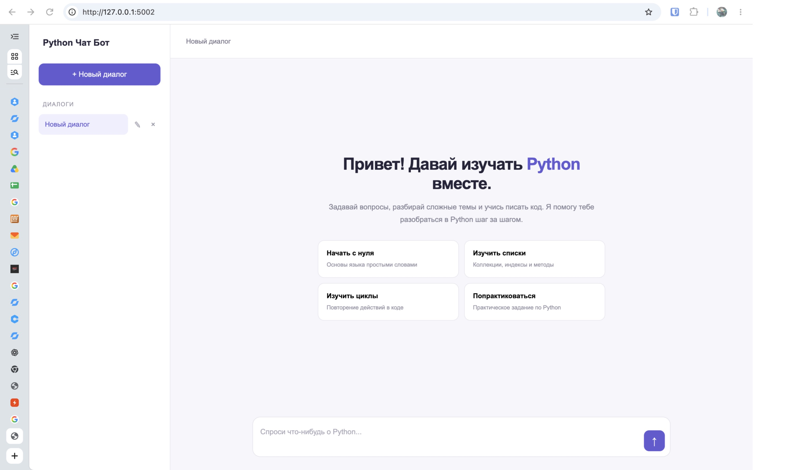
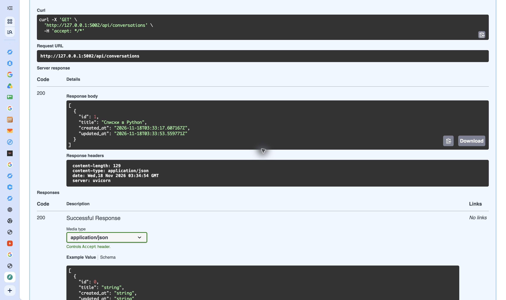
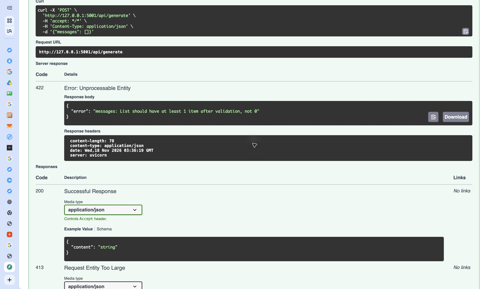
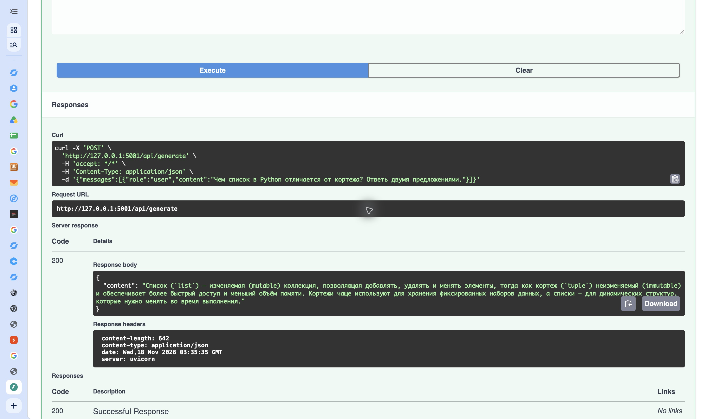

# Python Chat Bot

Веб приложение для изучения Python через переписку с LLM. Можно создавать и переименовывать диалоги, задавать вопросы, открывать историю и удалять диалоги вместе с сообщениями.

Браузер обращается к `chat_bot`, который сохраняет историю в SQLite и отправляет последние сообщения по HTTP в `llm_service`. LLM сервис добавляет инструкцию преподавателя Python, вызывает Groq и возвращает ответ.

## Пошаговый запуск через Docker Compose

Отдельно устанавливать Python и библиотеки не нужно: они устанавливаются при сборке контейнеров.

1. **Установите и запустите Docker Desktop.** Дождитесь, пока Docker будет готов к работе. Если Docker уже установлен, достаточно открыть приложение.

2. **Скачайте проект и распакуйте архив**, если он был передан архивом. Найдите папку `Python_chat_bot`, в которой лежат `compose.yaml`, `.env.example`, `chat_bot` и `llm_service`.

3. **Откройте терминал в этой папке.** Если терминал открыт в родительской папке, выполните:

   ```bash
   cd Python_chat_bot
   ```

   Все дальнейшие команды выполняются из папки с `compose.yaml`.

4. **Подготовьте настройки.** Создайте копию файла `.env.example` с именем `.env` в той же папке. В macOS и Linux можно выполнить:

   ```bash
   cp .env.example .env
   ```

   В Windows PowerShell:

   ```powershell
   Copy-Item .env.example .env
   ```

   Если вам уже передали готовый `.env`, поместите его рядом с `compose.yaml` и не перезаписывайте шаблоном.

5. **Укажите ключ Groq.** Откройте `.env` в текстовом редакторе и заполните строку:

   ```env
   GROQ_API_KEY=ваш_ключ
   ```

   Сохраните файл. Имя должно быть именно `.env`, без окончания `.txt`. Ключ можно получить у автора проекта отдельно или использовать собственный.

6. **Проверьте интернет.** Если Groq в вашей сети доступен только через VPN, включите его на компьютере с Docker. Трафик контейнеров тоже должен проходить через VPN. Если запросы блокируются, попробуйте другой VPN сервер или мобильный интернет.

7. **Соберите и запустите приложение:**

   ```bash
   docker compose up -d --build
   ```

   При первом запуске Docker скачает образы и установит зависимости, поэтому сборка может занять несколько минут. Параметр `-d` оставляет контейнеры работать в фоне.

8. **Проверьте, что оба сервиса запущены:**

   ```bash
   docker compose ps
   ```

   Для сервисов `chat_bot` и `llm` должен отображаться статус `Up`. Если сервис завершился или не отвечает, посмотрите ошибки:

   ```bash
   docker compose logs --tail 50 chat_bot llm
   ```

9. **Откройте приложение:** [http://localhost:5002](http://localhost:5002). Нажмите «Новый диалог» и отправьте, например: «Объясни, что такое список в Python. Покажи короткий пример кода».

10. **Откройте Swagger при необходимости:** [основной API](http://localhost:5002/docs) и [LLM API](http://localhost:5001/docs). Спецификации доступны по `/openapi.json` у каждого сервиса. Для загрузки оформления Swagger из CDN нужен интернет.

### Остановка и повторный запуск

Чтобы остановить приложение, выполните из той же папки:

```bash
docker compose down
```

Для повторного запуска:

```bash
docker compose up -d --build
```

Эта же команда применяется после изменения кода или `.env`. История сохраняется в Docker volume `chat_data` после обычной остановки. Команда `docker compose down -v` удаляет этот том вместе с историей, поэтому для обычной остановки параметр `-v` не нужен.

## Передача проекта преподавателю

В репозиторий загружается `.env.example` без настоящего ключа. Файл `.env` с ключом не нужно публиковать на GitHub: он уже исключён через `.gitignore` и `.dockerignore`.

Ключ Groq передаётся преподавателю отдельно личным сообщением. Желательно создать отдельный ключ для проверки курсовой и отозвать его после завершения проверки. Любой человек с этим ключом сможет обращаться к API в пределах доступных аккаунту квот.

После получения проекта преподавателю необходимо:

1. Скопировать `.env.example` в `.env` в корне проекта.
2. Открыть `.env` и указать полученный ключ вместо пустого значения:

   ```env
   GROQ_API_KEY=полученный_ключ
   ```

3. При необходимости включить VPN на компьютере с Docker.
4. Из корня проекта выполнить `docker compose up -d --build`.
5. Открыть http://localhost:5002.

Вместо переданного ключа преподаватель может использовать собственный ключ Groq. Если настоящий ключ уже попадал в Git, его нужно отозвать и создать новый: удаление файла из текущей версии не удаляет ключ из истории репозитория.

## Настройки

Основные настройки находятся в `.env`, параметры соединения сервисов и базы — в `compose.yaml`. Для обычного запуска достаточно заменить ключ; остальные значения можно оставить как в шаблоне.

### Файл .env

Файл находится рядом с `compose.yaml`. Укажите ключ и при необходимости измените основные настройки:

```env
GROQ_API_KEY=ваш_ключ
LLM_MODEL=openai/gpt-oss-20b
HISTORY_LIMIT=10
LLM_TIMEOUT=30
LLM_MAX_OUTPUT_TOKENS=2048
```

| Настройка | Назначение |
| --- | --- |
| `GROQ_API_KEY` | Ключ доступа к Groq. Передаётся отдельно и не публикуется в Git |
| `LLM_MODEL` | Название модели Groq |
| `HISTORY_LIMIT` | Количество последних сообщений, передаваемых модели, включая новое. Вопросы пользователя и ответы бота считаются отдельно; задавайте положительное целое число |
| `LLM_TIMEOUT` | Время ожидания ответа Groq в секундах. Время ожидания основного сервиса отдельно задано в Compose и равно 35 секундам |
| `LLM_MAX_OUTPUT_TOKENS` | Общий бюджет генерации, включая рассуждения модели. Не является ограничением количества слов в видимом ответе |

Остальные настройки берутся из кода. В `.env.example` приведён такой же набор параметров без настоящего ключа.

### Файл compose.yaml

Эти параметры основного сервиса уже заданы в разделе `chat_bot.environment`. Для их изменения нужно редактировать Compose, а не добавлять одноимённую строку в `.env`.

| Параметр | Назначение | Текущее значение |
| --- | --- | --- |
| `LLM_SERVICE_URL` | Адрес LLM сервиса внутри сети Docker. llm — имя сервиса в Compose | `http://llm:5001` |
| `LLM_TIMEOUT` | Сколько секунд основной сервис ждёт ответ LLM сервиса | `35` |
| `DATABASE_URL` | Адрес файла SQLite внутри контейнера | `sqlite:////data/chat.db` |
| `HISTORY_LIMIT` | Подстановка глубины истории из .env | `${HISTORY_LIMIT:-10}` |

Файл базы находится в Docker volume `chat_data`, подключённом к `/data`. Порты также указаны в `compose.yaml`: основной сервис — `5002:5002`, LLM сервис — `127.0.0.1:5001:5001`.

### Ограничения в коде

В браузере и основном API установлен предел сообщения 4000 символов. Увеличение `LLM_MAX_INPUT_LENGTH` в `.env` не повышает этот предел. Название диалога ограничено 255 символами. Эти ограничения меняются в исходниках.

Браузер ждёт запрос до 45 секунд. При изменении тайм аутов учитывайте всю цепочку: по умолчанию Groq ожидается до 30 секунд, основной сервис ждёт LLM сервис до 35 секунд, браузер — до 45 секунд. Увеличение одного значения не меняет остальные.

После изменения `.env`, `compose.yaml` или исходников примените настройки:

```bash
docker compose up -d --build
```

## Использование и ограничения

Нажмите «Новый диалог», введите вопрос по Python и отправьте его кнопкой или Enter. Shift+Enter добавляет перенос строки. Карандаш в списке диалогов позволяет переименовать диалог, крестик — удалить его с подтверждением.

Название ограничено 255 символами, сообщение — 4000. Общая длина контекста ограничена тройным значением `LLM_MAX_INPUT_LENGTH`; при превышении сервер возвращает ошибку. Тематическое ограничение реализовано инструкцией модели.

При ошибке модели основной сервис откатывает транзакцию сообщения, а интерфейс возвращает текст в поле ввода. После тайм аута браузера сервер может завершить запрос позднее: перед повторной отправкой проверьте историю диалога.

Файлы `.env`, базы и виртуальные окружения исключены из Git и контекста Docker. Исходные ключи и история из проекта на рабочем столе в эту копию не переносились. Приложение рассчитано на учебный локальный запуск, авторизация пользователей не реализована.

### Пустой ответ модели

Для GPT OSS бюджет ответа включает рассуждения. В коде по умолчанию задан бюджет 2048 токенов и уровень рассуждений low. Пустые ответы отклоняются и не сохраняются; старые пустые сообщения исключаются из контекста. После изменения конфигурации выполните `docker compose up -d --build`.

### Длина ответов и форматирование

По умолчанию бот отвечает кратко; подробное объяснение можно запросить в сообщении. Общий бюджет `LLM_MAX_OUTPUT_TOKENS` включает рассуждения модели и не задаёт желаемую длину видимого текста. Markdown отображается библиотекой Marked, подключённой через CDN. Для загрузки библиотеки нужен интернет; если она недоступна, ответы показываются обычным текстом. Встроенный HTML отображается как текст. Ссылки разрешены только с http и https; изображения из ответов не загружаются.

## Автоматическая документация FastAPI

Оба сервиса используют FastAPI и Pydantic. OpenAPI строится автоматически по маршрутам, схемам запросов и ответов. Стандартный Swagger UI FastAPI доступен на `/docs`; его ресурсы загружаются из CDN. Ошибки проверки входных данных возвращают статус `422` и поле `error`. Схема SQLite совместима с прежней версией: существующий Docker volume сохраняется.

LLM сервис возвращает только используемое поле `content` с текстом ответа.

## Тестирование приложения

Проверка выполнена 18 ноября 2026 года в Google Chrome на компьютере. Интерфейс и Swagger проверены на запущенных сервисах. В успешных запросах из браузера использовалась реальная модель Groq. Ответы модели могут отличаться при повторении тех же вопросов.

### Результаты проверок

| Сценарий | Способ проверки | Результат |
| --- | --- | --- |
| Создание диалога | Браузер | Диалог появляется в списке, ввод становится доступен |
| Отправка вопроса | Браузер и реальный Groq | Ответ показан в выбранном диалоге, код оформлен отдельным блоком |
| Контекст переписки | Уточняющий вопрос в браузере | Бот правильно назвал второй фрукт из предыдущего примера |
| Переименование | Браузер | Новое название отображается в панели и заголовке |
| Открытие сохранённой истории | Обновление страницы | Название и сообщения восстановлены |
| Пустое название | Браузер | Показано диагностическое сообщение, название не изменено |
| Отмена удаления | Браузер | Подтверждение показано, после отмены диалог сохранён |
| Swagger двух сервисов | Браузер | Страницы загрузились, маршруты и схемы доступны |
| Чтение списка диалогов | Swagger основного API | HTTP 200, получен список диалогов |
| Прямой вызов модели | Swagger LLM API и реальный Groq | HTTP 200, получен текст ответа |
| Пустой список messages | Swagger LLM API | HTTP 422 с описанием ошибки |
| Пустое сообщение, неверный тип и 4001 символ | Автоматические проверки FastAPI TestClient | Основной API возвращает HTTP 422 |
| Удаление с сообщениями | Автоматическая проверка на отдельной тестовой БД | Диалог и связанные сообщения удалены |
| Тайм аут модели | Автоматическая проверка с тестовой ошибкой | HTTP 504, история не пополнилась неуспешным сообщением |
| Некорректные роли и превышение размера входа LLM | Автоматические проверки LLM API | HTTP 422 для роли, HTTP 413 для слишком длинного текста |

Автоматические проверки выполнялись отдельно с тестовым ответом вместо Groq и не заменяют реальные браузерные проверки выше. Для тайм аута и сетевых ошибок реальная сеть намеренно не отключалась. Проверка сохранения истории после перезапуска Docker в этот прогон не входила.

### Скриншоты

Файлы находятся в `chat_bot/screenshots`. На снимках нет ключа API. Чтобы увеличить изображение, откройте его по нажатию.

<details>
<summary>Главная страница</summary>

Показаны назначение бота, тема Python и примеры вопросов. Пока диалог не создан, поле ввода недоступно.


</details>

<details>
<summary>Создание диалога</summary>

Кнопка «Новый диалог» добавляет запись в боковую панель и включает поле ввода.



</details>

<details>
<summary>Получение ответа и оформление кода</summary>

Вопрос: «Объясни, что такое список в Python. Создай список из трёх фруктов и покажи, как добавить четвёртый». Получен реальный ответ Groq с блоком кода.


</details>

<details>
<summary>Продолжение переписки</summary>

Вопрос: «Какой фрукт стоит вторым в списке из твоего примера? Ответь одним словом». Бот ответил «банан», то есть использовал предыдущие сообщения.


</details>

<details>
<summary>Переименование и сохранение истории</summary>

Диалог переименован в «Списки в Python». После обновления страницы сохранились название и оба вопроса с ответами.


</details>

<details>
<summary>Проверка пустого названия</summary>

Попытка сохранить пустое название отклонена. В интерфейсе появилось сообщение «Название не может быть пустым».


</details>

<details>
<summary>Подтверждение удаления</summary>

При нажатии крестика появляется вопрос об удалении. В браузерном тесте выбрана отмена: диалог и история сохранены.


</details>

<details>
<summary>Swagger основного сервиса</summary>

На /docs отображаются операции создания, чтения, переименования, удаления диалогов и отправки сообщений, а также схемы данных.


</details>

<details>
<summary>Выполнение запроса через Swagger</summary>

GET /api/conversations выполнен кнопками Try it out и Execute. Получен HTTP 200 со списком диалогов.



</details>

<details>
<summary>Swagger LLM сервиса</summary>

Отдельная документация сервиса на порту 5001 содержит POST /api/generate и схемы запроса и ответа.


</details>

<details>
<summary>Ошибка валидации через Swagger</summary>

Запрос {"messages": []} отклонён с HTTP 422. В ответе указано, что нужен хотя бы один элемент списка.



</details>

<details>
<summary>Реальная генерация через Swagger</summary>

Вопрос: «Чем список в Python отличается от кортежа? Ответь двумя предложениями». Получен HTTP 200 и непустой текст в поле content.



</details>

## Диагностические сообщения

Сообщения интерфейса и API могут отображаться на русском или английском языке. При ошибке отправки дополнительно показывается предложение проверить интернет и VPN на компьютере, где работает LLM сервис. Эта подсказка не означает, что причиной всегда является VPN.

| Сообщение или признак | Почему возникло | Что можно попробовать сделать |
| --- | --- | --- |
| «Сначала создайте диалог» | Нет выбранного диалога для сообщения | Нажать «Новый диалог» или выбрать существующий |
| «Название не может быть пустым» | При переименовании введена пустая строка или пробелы | Указать название длиной от 1 до 255 символов |
| «Максимум 4000 символов» | Слишком длинный текст сообщения | Сократить текст или разделить вопрос на несколько сообщений |
| HTTP 422, `title: ...` или `content: ...` | Не передано обязательное поле, передан неверный тип, нарушена длина | Проверить тело JSON; title и content должны быть непустыми строками, название — до 255, сообщение — до 4000 символов |
| HTTP 422, `messages: List should have at least 1 item ...` | LLM сервис получил пустой список messages | Передать хотя бы одно сообщение с role и content |
| HTTP 422 с указанием `role` | Роль сообщения не входит в допустимый список | Использовать user, assistant или system |
| «Сообщение не должно быть пустым» | LLM сервис получил текст из одних пробелов | Ввести содержательный текст |
| «Превышена максимальная длина сообщения» (413) | Последнее сообщение больше LLM_MAX_INPUT_LENGTH | Сократить сообщение или согласованно изменить лимиты; основной API всё равно ограничивает ввод 4000 символами |
| «Превышена максимальная длина контекста» (413) | Сумма текстов истории больше LLM_MAX_INPUT_LENGTH × 3 | Уменьшить HISTORY_LIMIT, начать новый диалог или сократить сообщения |
| «Диалог не найден» (404) | Запрошен отсутствующий или уже удалённый id | Обновить список диалогов, выбрать существующий или создать новый |
| «Не настроен GROQ_API_KEY» | Ключ не указан в окружении LLM сервиса | Заполнить GROQ_API_KEY в .env и пересоздать контейнеры |
| `Invalid API key` | Groq отклонил ключ | Проверить ключ на опечатки, срок действия и отзыв; при необходимости создать новый и заменить в .env |
| `LLM service unavailable: ...` | Основной сервис не может подключиться к LLM сервису | Проверить `docker compose ps` и логи; в Compose адрес должен быть http://llm:5001, при локальном запуске — http://localhost:5001 |
| `LLM connection failed` | LLM сервис не смог подключиться к Groq | Проверить интернет и VPN, попробовать другой VPN сервер или мобильный интернет; проверить доступность API из контейнера |
| `LLM API error: ... 403 ... Access denied ...` | Groq отклоняет запрос с текущего сетевого маршрута; точная причина зависит от ответа провайдера | Попробовать другую сеть или VPN сервер, сравнить доступ с компьютера и из Docker; доступность сайта консоли отдельно не гарантирует доступ к API |
| `LLM service timeout` или `LLM request timeout` (504) | Сервис или модель не ответили за отведённое время | Проверить сеть, повторить позже; при увеличении тайм аута учитывать тайм аут основного сервиса и предел ожидания браузера 45 секунд |
| Ошибка ожидания браузера | Запрос выполнялся дольше 45 секунд | Сначала заново открыть диалог: сервер мог успеть сохранить ответ; затем при необходимости повторить отправку |
| `LLM rate limit exceeded, try again later` | Превышена квота или частота запросов Groq | Подождать и повторить запрос, проверить доступные лимиты аккаунта |
| «Модель вернула пустой ответ…» | Groq не вернул видимый текст, например бюджет закончился на рассуждениях | Повторить запрос; проверить LLM_MAX_OUTPUT_TOKENS и LLM_REASONING_EFFORT. Пустые ответы в историю не сохраняются |
| «LLM сервис вернул некорректный JSON» | Вместо ожидаемого JSON пришёл другой ответ | Проверить адрес LLM сервиса, его логи и возможный промежуточный прокси |
| «Ошибка обращения к модели» | Неожиданная ошибка внутри LLM сервиса | Посмотреть `docker compose logs llm`, проверить настройки модели и доступ к Groq |
| «Не удалось загрузить диалоги», «Ошибка загрузки сообщений» | Основной API недоступен или запрос завершился ошибкой | Проверить запуск сервиса и `docker compose logs chat_bot`, затем обновить страницу |
| «Не удалось создать диалог», «Не удалось переименовать…», «Не удалось удалить диалог» | Операция основного API не завершилась успешно | Проверить название, наличие диалога, состояние сервиса и сообщение в логах |
| Swagger остаётся пустым или ответы без оформления Markdown | Браузер не загрузил библиотеку с CDN | Проверить интернет, доступ к cdn.jsdelivr.net и обновить страницу. При недоступности Marked чат показывает обычный текст |

После изменения `.env` или исходников примените настройки из корня проекта:

```bash
docker compose up -d --build
```

Для просмотра состояния и последних ошибок:

```bash
docker compose ps
docker compose logs --tail 50 chat_bot llm
```
