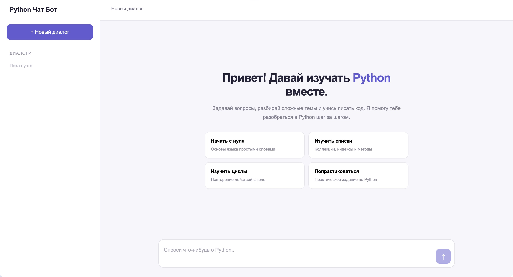
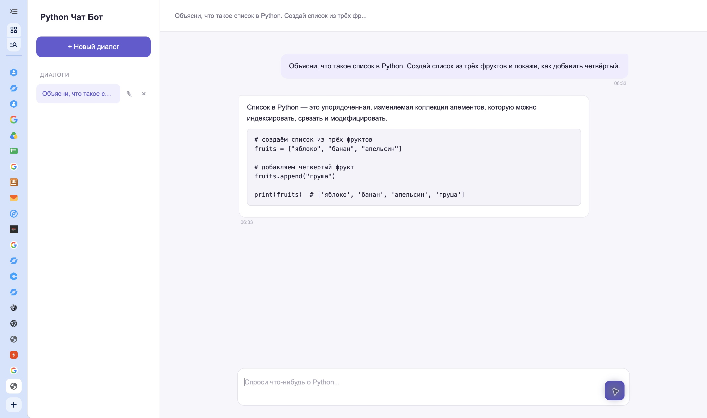
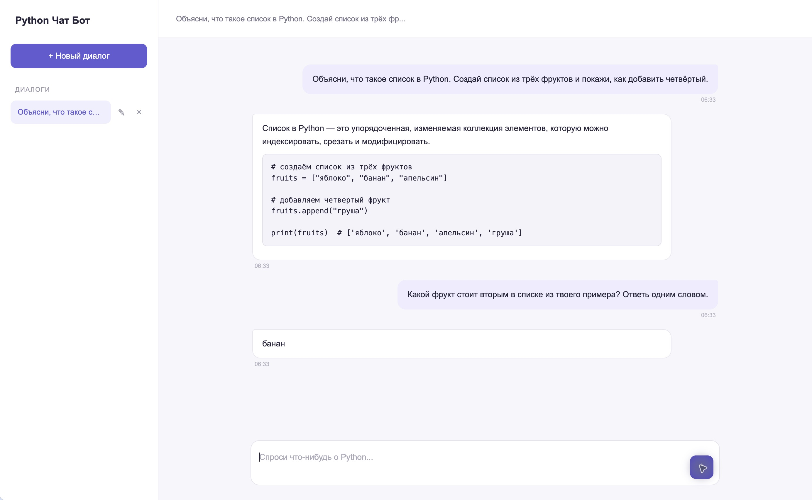
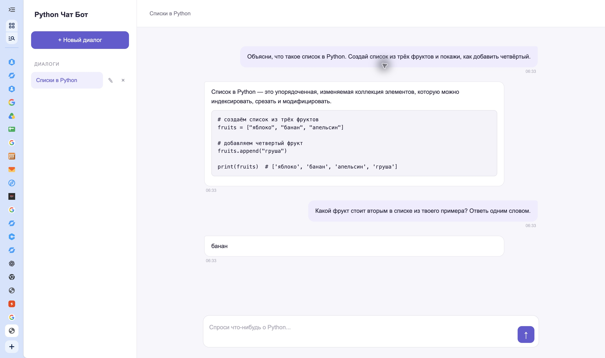
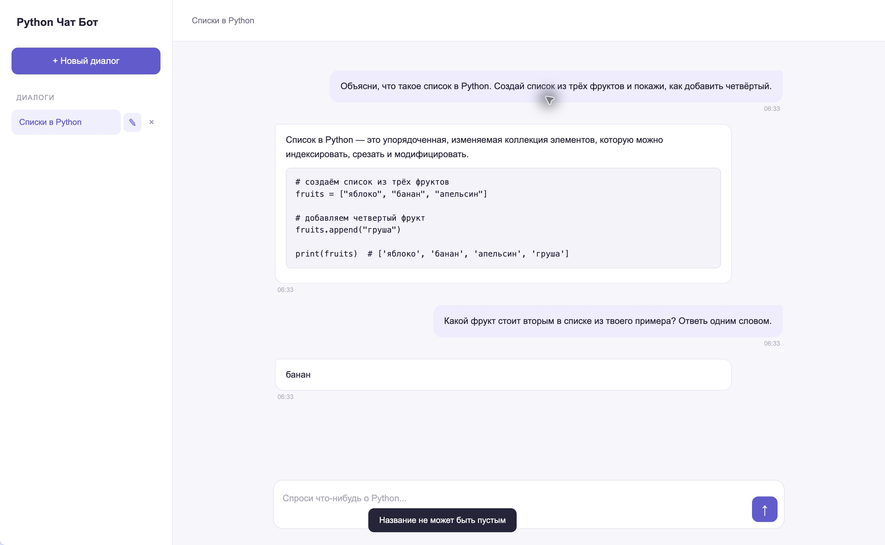
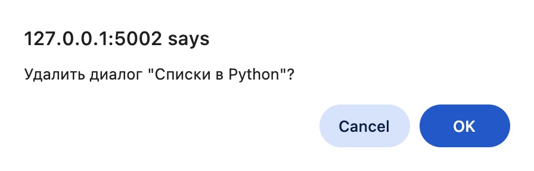
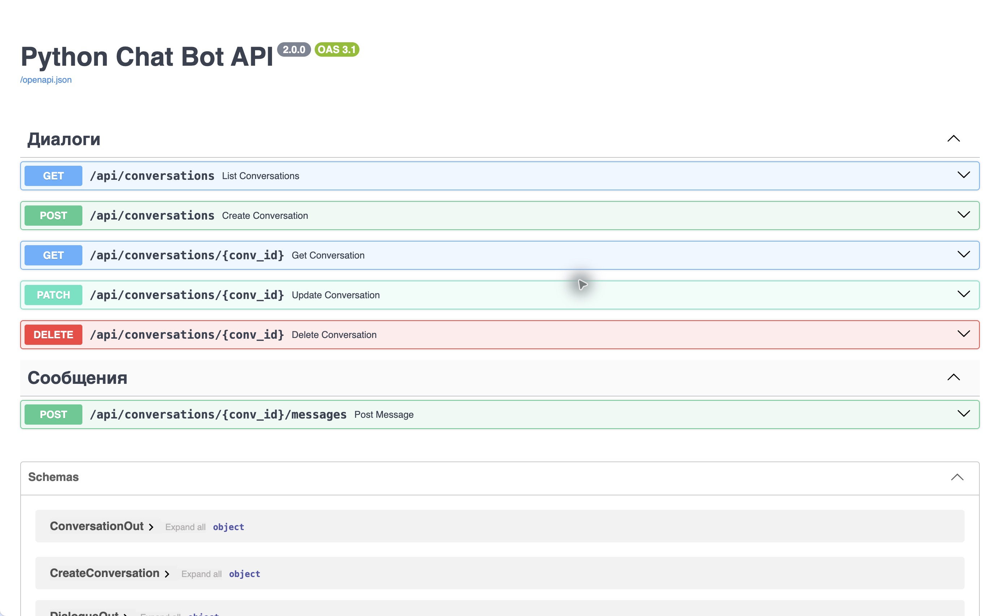
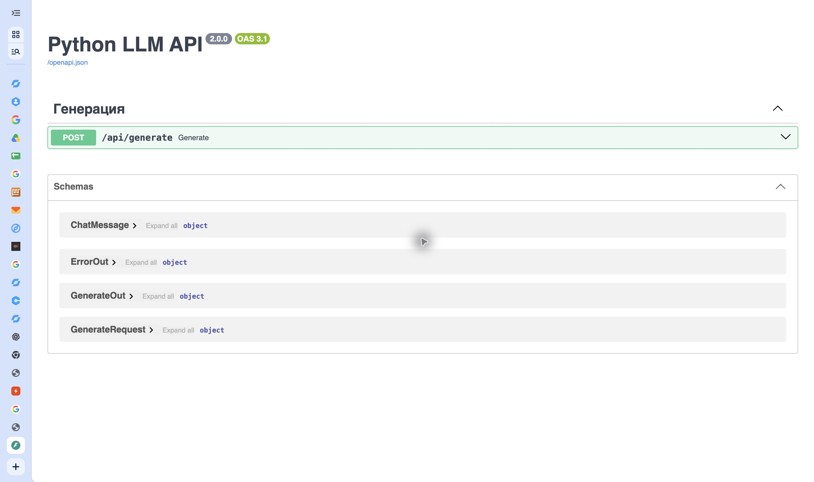

# Python Chat Bot

Веб приложение для изучения Python через переписку с LLM. Можно создавать и переименовывать диалоги, задавать вопросы, открывать историю и удалять диалоги вместе с сообщениями.

Браузер обращается к chat_bot, который сохраняет историю в SQLite и отправляет последние сообщения по HTTP в llm_service. LLM сервис добавляет инструкцию преподавателя Python, вызывает Groq и возвращает ответ.

## Пошаговый запуск через Docker Compose

1. **Установите и запустите Docker Desktop.**

2. **Скачайте проект и распакуйте архив**

3. **Откройте терминал в этой папке.** 

   ```bash
   cd Python_chat_bot
   ```

4. **Подготовьте настройки.** 

   Создайте копию файла `.env.example` с именем `.env` в той же папке.

   Если вам уже передали готовый `.env`, поместите его рядом с `compose.yaml` и не перезаписывайте шаблоном. Шаг 5 пропустите. 

5. **Укажите ключ Groq.** Откройте `.env` в текстовом редакторе и заполните строку:

   ```env
   GROQ_API_KEY=ваш_ключ
   ```

6. **Проверьте интернет.** Если Groq в вашей сети доступен только через VPN, включите его на компьютере с Docker. Трафик контейнеров тоже должен проходить через VPN. Если запросы блокируются, попробуйте другой VPN сервер или мобильный интернет.

7. **Соберите и запустите приложение:**

   ```bash
   docker compose up -d --build
   ```
   
8. **Проверьте, что оба сервиса запущены:**

   ```bash
   docker compose ps
   ```

9. **Откройте приложение:** [http://localhost:5002](http://localhost:5002).

10. **Откройте Swagger при необходимости:** [http://localhost:5002/docs](http://localhost:5002/docs).

### Остановка и повторный запуск

Чтобы остановить приложение, выполните из той же папки:

```bash
docker compose down
```

Для повторного запуска:

```bash
docker compose up -d --build
```

### Файл .env

```env
GROQ_API_KEY=ваш_ключ
LLM_MODEL=openai/gpt-oss-20b
HISTORY_LIMIT=10
LLM_TIMEOUT=30
LLM_MAX_OUTPUT_TOKENS=2048
```

| Настройка | Назначение |
| --- | --- |
| `GROQ_API_KEY` | Ключ доступа к Groq. Передаётся отдельно и не публикуется в Git |
| `LLM_MODEL` | Название модели Groq |
| `HISTORY_LIMIT` | Количество последних сообщений, передаваемых модели, включая новое. Вопросы пользователя и ответы бота считаются отдельно; задавайте положительное целое число |
| `LLM_TIMEOUT` | Время ожидания ответа Groq в секундах. Время ожидания основного сервиса отдельно задано в Compose и равно 35 секундам |
| `LLM_MAX_OUTPUT_TOKENS` | Общий бюджет генерации, включая рассуждения модели. Не является ограничением количества слов в видимом ответе |

### Тестирование

<details>
<summary>Главная страница</summary>

Показаны назначение бота, тема Python и примеры вопросов. Пока диалог не создан, поле ввода недоступно.



</details>

<details>
<summary>Создание диалога</summary>

Кнопка «Новый диалог» добавляет запись в боковую панель и включает поле ввода.


</details>

<details>
<summary>Получение ответа и оформление кода</summary>

Вопрос: «Объясни, что такое список в Python. Создай список из трёх фруктов и покажи, как добавить четвёртый». Получен реальный ответ Groq с блоком кода.



</details>

<details>
<summary>Продолжение переписки</summary>

Вопрос: «Какой фрукт стоит вторым в списке из твоего примера? Ответь одним словом». Бот ответил «банан», то есть использовал предыдущие сообщения.



</details>

<details>
<summary>Переименование и сохранение истории</summary>

Диалог переименован в «Списки в Python». После обновления страницы сохранились название и оба вопроса с ответами.



</details>

<details>
<summary>Проверка пустого названия</summary>

Попытка сохранить пустое название отклонена. В интерфейсе появилось сообщение «Название не может быть пустым».



</details>

<details>
<summary>Подтверждение удаления</summary>

При нажатии крестика появляется вопрос об удалении. В браузерном тесте выбрана отмена: диалог и история сохранены.



</details>

<details>
<summary>Swagger основного сервиса</summary>

На /docs отображаются операции создания, чтения, переименования, удаления диалогов и отправки сообщений, а также схемы данных.



</details>

<details>
<summary>Выполнение запроса через Swagger</summary>

GET /api/conversations выполнен кнопками Try it out и Execute. Получен HTTP 200 со списком диалогов.


</details>

<details>
<summary>Swagger LLM сервиса</summary>

Отдельная документация сервиса на порту 5001 содержит POST /api/generate и схемы запроса и ответа.



</details>

<details>
<summary>Ошибка валидации через Swagger</summary>

Запрос {"messages": []} отклонён с HTTP 422. В ответе указано, что нужен хотя бы один элемент списка.


</details>

<details>
<summary>Реальная генерация через Swagger</summary>

Вопрос: «Чем список в Python отличается от кортежа? Ответь двумя предложениями». Получен HTTP 200 и непустой текст в поле content.


</details>

## Диагностические сообщения

Сообщения интерфейса и API могут отображаться на русском или английском языке. При ошибке отправки дополнительно показывается предложение проверить интернет и VPN на компьютере, где работает LLM сервис. Эта подсказка не означает, что причиной всегда является VPN.

| Сообщение или признак | Почему возникло | Что можно попробовать сделать |
| --- | --- | --- |
| «Сначала создайте диалог» | Нет выбранного диалога для сообщения | Нажать «Новый диалог» или выбрать существующий |
| «Название не может быть пустым» | При переименовании введена пустая строка или пробелы | Указать название длиной от 1 до 255 символов |
| «Максимум 4000 символов» | Слишком длинный текст сообщения | Сократить текст или разделить вопрос на несколько сообщений |
| HTTP 422, `title: ...` или `content: ...` | Не передано обязательное поле, передан неверный тип, нарушена длина | Проверить тело JSON; title и content должны быть непустыми строками, название — до 255, сообщение — до 4000 символов |
| HTTP 422, `messages: List should have at least 1 item ...` | LLM сервис получил пустой список messages | Передать хотя бы одно сообщение с role и content |
| HTTP 422 с указанием `role` | Роль сообщения не входит в допустимый список | Использовать user, assistant или system |
| «Сообщение не должно быть пустым» | LLM сервис получил текст из одних пробелов | Ввести содержательный текст |
| «Превышена максимальная длина сообщения» (413) | Последнее сообщение больше LLM_MAX_INPUT_LENGTH | Сократить сообщение или согласованно изменить лимиты; основной API всё равно ограничивает ввод 4000 символами |
| «Превышена максимальная длина контекста» (413) | Сумма текстов истории больше LLM_MAX_INPUT_LENGTH × 3 | Уменьшить HISTORY_LIMIT, начать новый диалог или сократить сообщения |
| «Диалог не найден» (404) | Запрошен отсутствующий или уже удалённый id | Обновить список диалогов, выбрать существующий или создать новый |
| «Не настроен GROQ_API_KEY» | Ключ не указан в окружении LLM сервиса | Заполнить GROQ_API_KEY в .env и пересоздать контейнеры |
| `Invalid API key` | Groq отклонил ключ | Проверить ключ на опечатки, срок действия и отзыв; при необходимости создать новый и заменить в .env |
| `LLM service unavailable: ...` | Основной сервис не может подключиться к LLM сервису | Проверить `docker compose ps` и логи; в Compose адрес должен быть http://llm:5001, при локальном запуске — http://localhost:5001 |
| `LLM connection failed` | LLM сервис не смог подключиться к Groq | Проверить интернет и VPN, попробовать другой VPN сервер или мобильный интернет; проверить доступность API из контейнера |
| `LLM API error: ... 403 ... Access denied ...` | Groq отклоняет запрос с текущего сетевого маршрута; точная причина зависит от ответа провайдера | Попробовать другую сеть или VPN сервер, сравнить доступ с компьютера и из Docker; доступность сайта консоли отдельно не гарантирует доступ к API |
| `LLM service timeout` или `LLM request timeout` (504) | Сервис или модель не ответили за отведённое время | Проверить сеть, повторить позже; при увеличении тайм аута учитывать тайм аут основного сервиса и предел ожидания браузера 45 секунд |
| Ошибка ожидания браузера | Запрос выполнялся дольше 45 секунд | Сначала заново открыть диалог: сервер мог успеть сохранить ответ; затем при необходимости повторить отправку |
| `LLM rate limit exceeded, try again later` | Превышена квота или частота запросов Groq | Подождать и повторить запрос, проверить доступные лимиты аккаунта |
| «Модель вернула пустой ответ…» | Groq не вернул видимый текст, например бюджет закончился на рассуждениях | Повторить запрос; проверить LLM_MAX_OUTPUT_TOKENS и LLM_REASONING_EFFORT. Пустые ответы в историю не сохраняются |
| «LLM сервис вернул некорректный JSON» | Вместо ожидаемого JSON пришёл другой ответ | Проверить адрес LLM сервиса, его логи и возможный промежуточный прокси |
| «Ошибка обращения к модели» | Неожиданная ошибка внутри LLM сервиса | Посмотреть `docker compose logs llm`, проверить настройки модели и доступ к Groq |
| «Не удалось загрузить диалоги», «Ошибка загрузки сообщений» | Основной API недоступен или запрос завершился ошибкой | Проверить запуск сервиса и `docker compose logs chat_bot`, затем обновить страницу |
| «Не удалось создать диалог», «Не удалось переименовать…», «Не удалось удалить диалог» | Операция основного API не завершилась успешно | Проверить название, наличие диалога, состояние сервиса и сообщение в логах |
| Swagger остаётся пустым или ответы без оформления Markdown | Браузер не загрузил библиотеку с CDN | Проверить интернет, доступ к cdn.jsdelivr.net и обновить страницу. При недоступности Marked чат показывает обычный текст |
